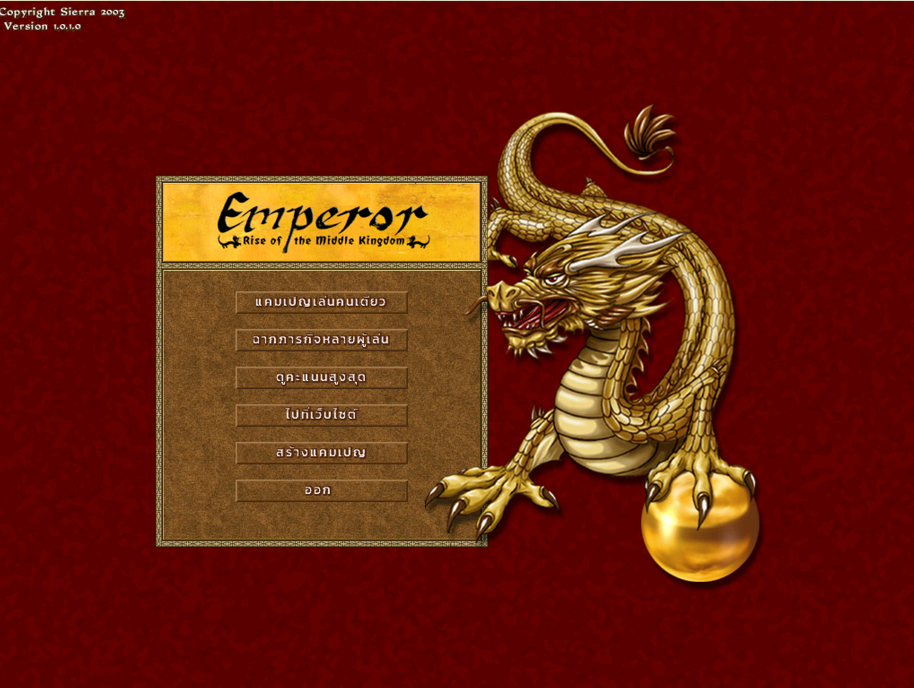
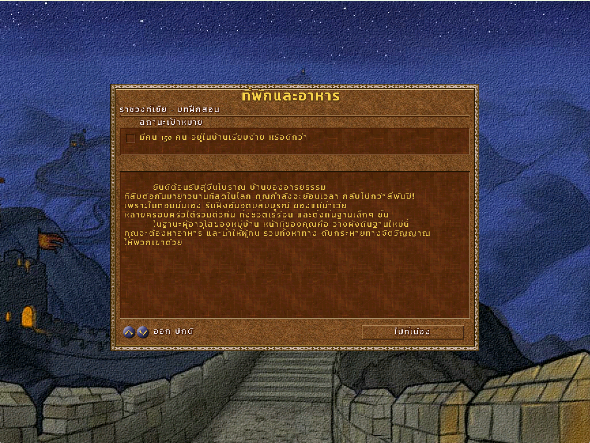
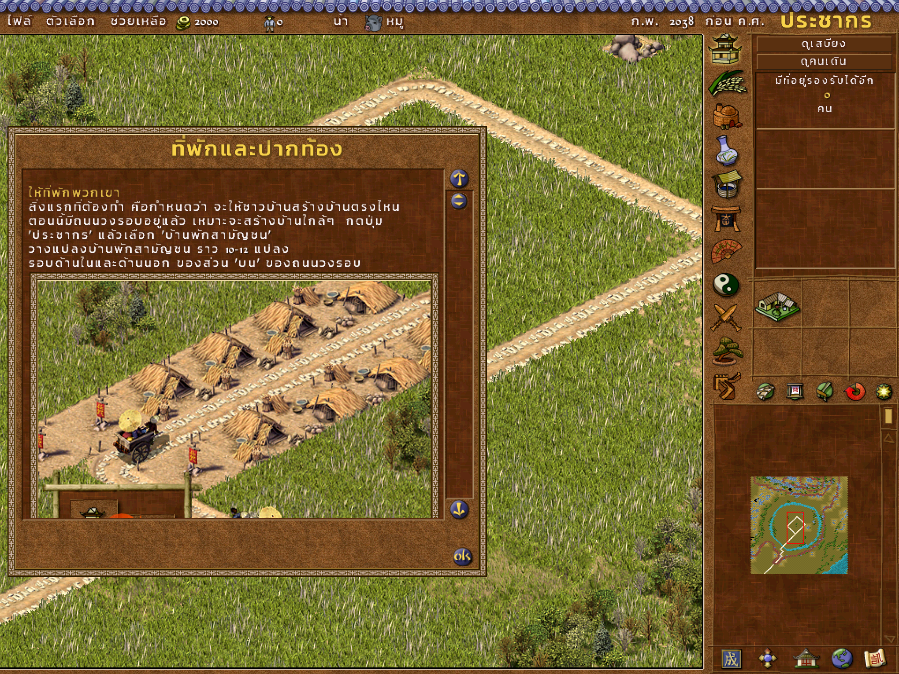

<div align="center">

# 🐉 Emperor: Rise of the Middle Kingdom — Thai Mod

### ม็อดภาษาไทยสำหรับเกม Emperor: Rise of the Middle Kingdom (2002)

แปลทั้งเกมเป็นภาษาไทยแบบภาษาพูด อ่านง่าย ไม่ใช่ Google Translate
พร้อมฟอนต์ไทยที่วาดใหม่ให้เข้ากับสไตล์เกม และระบบวางสระ/วรรณยุกต์ที่ถูกต้อง


</div>

[](https://buymeacoffee.com/maxkii3)

<div align="center">
  <a href="https://www.gsttopup.com/shop" target="_blank">
    
  </a>
  <br/>
  <sub>🎮 <b>Sponsored by / สนับสนุนโดย:</b> <a href="https://www.gsttopup.com/shop">GST Topup</a></sub>
  <br/>
  <sub><b>TH:</b> เติมเกมถูก รวดเร็ว ปลอดภัย แนะนำที่ GST Topup | <b>EN:</b> Affordable, fast, and secure game top-ups at GST Topup</sub>
</div>

---

## 📸 ภาพตัวอย่าง / Screenshots

<div align="center">
  
  <br/><sub>เมนูหลัก / Main menu</sub>
  <br/><br/>
  
  <br/><sub>หน้าบรรยายภารกิจ / Mission briefing</sub>
  <br/><br/>
  
  <br/><sub>คำแนะนำระหว่างเล่น / In-game tutorial message</sub>
</div>

---

## ✨ มีอะไรบ้าง / Features

| | |
|---|---|
| 🈶 **แปลครบทั้งเกม** | เมนู ปุ่ม สิ่งก่อสร้าง สินค้า รายงานที่ปรึกษา คำพูดชาวเมือง (~5,800 ข้อความ) หน้าช่วยเหลือ (676 หน้า) ข้อความแจ้งเตือน/จดหมายจากเมืองอื่น/ที่ปรึกษา (~1,500 ข้อความ) และสุภาษิตจีน |
| 🗣️ **ภาษาคน อ่านง่าย** | แปลแบบนักแปลเกม ใช้คลังศัพท์เดียวกันทั้งเกม ชื่อที่คนไทยคุ้นเคยใช้แบบไทย เช่น ซุนหงอคง, กวนอู, ขงจื๊อ, จิ๋นซีฮ่องเต้ |
| 🔤 **ฟอนต์ไทย 30 แบบ** | วาดตัวอักษรไทยเพิ่มเข้าไปในฟอนต์ทุกขนาด/ทุกสีของเกม ให้มีขอบและเงาแบบเดียวกับตัวอังกฤษเดิม |
| 📐 **สระ & วรรณยุกต์ถูกตำแหน่ง** | แก้ตัวเกมให้วางสระบน/ล่างและวรรณยุกต์ซ้อนได้ ยกวรรณยุกต์ขึ้นเมื่อมีสระบน และหลบหาง ป ฝ ฟ ฬ |
| ↩️ **ถอนการติดตั้งได้** | สำรองไฟล์ต้นฉบับไว้ให้อัตโนมัติ คืนค่าได้ด้วยคำสั่งเดียว |

> ชื่อคนและชื่อเมืองที่เกมสุ่มขึ้นมา ตั้งใจคงไว้เป็นภาษาอังกฤษ

---

## 📦 ติดตั้ง / Installation

**ต้องมี / Requirements**
- Emperor: Rise of the Middle Kingdom **เวอร์ชัน 1.0.1.0 ภาษาอังกฤษ** (ติดตั้งแพตช์ทางการ 1.0.1.0 แล้ว)
- [Python 3.8+](https://www.python.org/downloads/) (ตอนติดตั้งให้ติ๊ก *Add Python to PATH*)

**ขั้นตอน**
1. ดาวน์โหลด repo นี้ (ปุ่ม **Code → Download ZIP**) แล้วแตกไฟล์
2. **ปิดเกมก่อน** แล้วดับเบิลคลิก `install.bat` ใส่โฟลเดอร์ที่ลงเกมไว้ เช่น `D:\Sierra\Emperor`
   หรือรันเอง:
   ```bat
   python patcher\install_thai_mod.py "D:\Sierra\Emperor"
   ```
3. เปิดเกม เล่นได้เลย 🎉

**ถอนการติดตั้ง / Uninstall**
```bat
python patcher\install_thai_mod.py "D:\Sierra\Emperor" --uninstall
```
ไฟล์ต้นฉบับถูกเก็บไว้ที่ `<โฟลเดอร์เกม>\_ThaiMod_backup`

> ตัวติดตั้งจะสร้างไฟล์ม็อดจากไฟล์เกมของคุณเอง repo นี้จึงไม่ได้แจกจ่ายไฟล์ของเกมต้นฉบับ

---

## 🖥️ เล่นบน Windows 10/11 จอใหญ่ (แนะนำ)

เกมเก่ายุค DirectDraw มักเปิดไม่ขึ้นหรือภาพเพี้ยนบน Windows รุ่นใหม่ แนะนำให้ใช้ **[cnc-ddraw](https://github.com/FunkyFr3sh/cnc-ddraw)** (วาง `ddraw.dll` + `ddraw.ini` ในโฟลเดอร์เกม) แล้วตั้งค่าใน `ddraw.ini`:

```ini
[ddraw]
width=2048          ; ขนาดหน้าต่าง (1024x768 x2 คมชัด)
height=1536
fullscreen=false
windowed=true
maintas=false       ; true = คงสัดส่วน 4:3 (มีขอบดำ), false = ยืดเต็มจอ
shader=Shaders\nearest-neighbor.glsl
d3d9_filter=0       ; ขยายแบบพิกเซลคม ไม่เบลอ
toggle_upscaled=true
keytogglefullscreen2=0x7A   ; F11 สลับเต็มจอ/หน้าต่าง (หรือ Alt+Enter)
```

ในเกมเลือก Display Options → **ความละเอียด 1024 x 768**

---

## 🗂️ โครงสร้าง repo / Repository layout

```
patcher/
  install_thai_mod.py     ตัวติดตั้ง (Python มาตรฐาน ไม่ต้องลงอะไรเพิ่ม)
  data/exe_patch.json     แพตช์ตัวเกมสำหรับวางสระ/วรรณยุกต์ไทย
  data/thai_glyphs.*      รูปตัวอักษรไทยสำหรับฟอนต์ทั้ง 30 แบบ
translations/
  EmperorText.th.json     ข้อความเมนู/ตัวเกม (รหัสข้อความ → ไทย)
  EmperorMM.th.json       หน้าช่วยเหลือ (รหัสข้อความ → ไทย)
  EmperorEventmsg.th.json ข้อความแจ้งเตือนและจดหมายเหตุการณ์ (Model\EmperorEventmsg.txt)
  Proverbs.th.json        สุภาษิตจีน (Model\Proverbs.txt)
  glossary.md             คลังคำศัพท์ที่ใช้ทั้งเกม
install.bat
```

อยากช่วยแก้คำแปล? แก้ใน `translations/*.json` (ช่อง `th`) แล้วส่ง Pull Request ได้เลย
ข้อความยาวควรเว้นวรรคระหว่างวลี เพราะเกมตัดบรรทัดตรงช่องว่างเท่านั้น

---

## 🔧 รายละเอียดทางเทคนิค / Technical notes

- เกมใช้ฟอนต์แบบรูปภาพ (`China_Fonts.sg3/.555`) ที่มีแค่ตัวละติน ม็อดนี้เพิ่มรูปอักษรไทย 108 ตัวต่อฟอนต์ (รวมรูปแปรของวรรณยุกต์/สระสำหรับตำแหน่งสูง-ต่ำ-หลบหาง)
- ข้อความไทยถูกเข้ารหัสเป็นรหัสไบต์เดี่ยวแบบ TIS-620 พร้อมรหัสเสริมช่วง `0x80–0x95` สำหรับรูปแปร
- แพตช์ `Emperor.exe` เปลี่ยนตารางตัวอักษร และเพิ่มโค้ดให้รูปอักษรไทยมีจุดวาด/ระยะเลื่อนของตัวเอง ทำให้สระและวรรณยุกต์ไม่กินที่ ไม่ได้ยุ่งกับระบบอื่นของเกม

---

## ⚠️ ข้อจำกัดความรับผิดชอบ / Disclaimer

ม็อดนี้เป็นงานของแฟนเกม ไม่ได้เกี่ยวข้องกับ Sierra, Impressions Games, BreakAway Games หรือเจ้าของลิขสิทธิ์ใดๆ
*Emperor: Rise of the Middle Kingdom* เป็นเครื่องหมายการค้าของเจ้าของลิขสิทธิ์ ต้องมีเกมของแท้เพื่อใช้ม็อดนี้

This is an unofficial fan translation. You need your own legitimate copy of the game.
